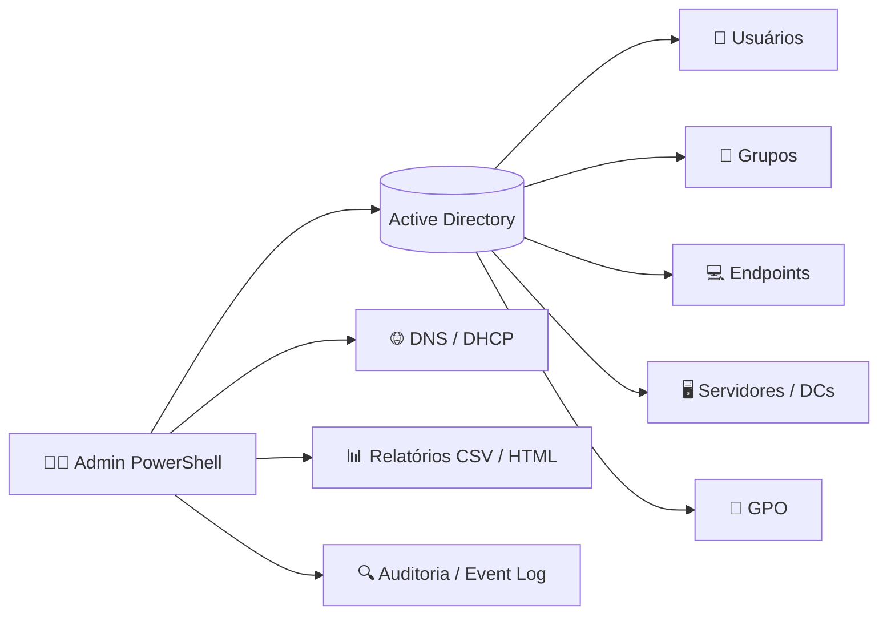

<div align="center">

# 🛡️ Gerenciamento de Contas Active Directory
### PowerShell Guide — comandos essenciais para administração de redes, usuários, endpoints e servidores


**Comandos curtos, diretos e testados no dia a dia — para resolver problemas, agir em massa, monitorar e auditar.**

[🚀 Começar](#-pré-requisitos) •
[👤 Usuários](#-1-usuários) •
[💻 Endpoints](#-3-computadores--endpoints) •
[🖥️ Servidores](#-4-servidores--domain-controllers) •
[🔍 Auditoria](#-5-auditoria--segurança) •
[🌐 Rede](#-6-rede-dns-e-dhcp)

</div>

---

## 📚 Sumário

| # | Seção | O que você encontra |
|---|-------|---------------------|
| 0 | [Pré-requisitos](#-pré-requisitos) | Módulo AD, RSAT, convenções |
| 1 | [Usuários](#-1-usuários) | Criar, buscar, resetar, desbloquear, desativar |
| 2 | [Grupos](#-2-grupos) | Membros, aninhamento, comparação |
| 3 | [Computadores / Endpoints](#-3-computadores--endpoints) | Inativos, OS, limpeza, LAPS |
| 4 | [Servidores / DCs](#-4-servidores--domain-controllers) | FSMO, replicação, saúde |
| 5 | [Auditoria & Segurança](#-5-auditoria--segurança) | Privilégios, lockouts, SPNs, delegação |
| 6 | [Rede, DNS e DHCP](#-6-rede-dns-e-dhcp) | Resolução, leases, conectividade |
| 7 | [GPO](#-7-gpo) | Atualização, relatórios, backup |
| 8 | [Execução em massa](#-8-execução-em-massa-e-remota) | Invoke-Command, paralelismo |
| 9 | [Relatórios](#-9-relatórios-csv-e-html) | Exportar para CSV / HTML |
| 10 | [Boas práticas](#-10-boas-práticas) | `-WhatIf`, logs, least privilege |

---

## 🗺️ Visão geral



---

## 🚀 Pré-requisitos

```powershell
# Windows Server: instalar o módulo AD
Install-WindowsFeature RSAT-AD-PowerShell

# Windows 10/11: instalar RSAT
Add-WindowsCapability -Online -Name "Rsat.ActiveDirectory.DS-LDS.Tools~~~~0.0.1.0"

# Carregar e validar
Import-Module ActiveDirectory
Get-ADDomain | Select-Object DNSRoot, NetBIOSName, DomainMode
```

> 💡 **Convenção deste guia:** `dominio.local` e `DC=dominio,DC=local` são exemplos. Troque pelo seu domínio.
> 🧪 **Dica de ouro:** antes de qualquer ação destrutiva, adicione `-WhatIf` para simular.

---

## 👤 1. Usuários

<details open>
<summary><b>🔎 Consultar e localizar</b></summary>

```powershell
# Dados completos de um usuário
Get-ADUser jsilva -Properties *

# Buscar por nome parcial
Get-ADUser -Filter "Name -like '*silva*'" | Select Name, SamAccountName, Enabled

# Último logon (replicado, ~14 dias de precisão)
Get-ADUser jsilva -Properties LastLogonDate | Select Name, LastLogonDate

# Quando a senha expira
Get-ADUser jsilva -Properties msDS-UserPasswordExpiryTimeComputed |
  Select Name, @{n='Expira';e={[datetime]::FromFileTime($_.'msDS-UserPasswordExpiryTimeComputed')}}

# Grupos do usuário
Get-ADPrincipalGroupMembership jsilva | Select Name
```
</details>

<details>
<summary><b>🛠️ Resolver problemas do dia a dia</b></summary>

```powershell
# Desbloquear conta
Unlock-ADAccount -Identity jsilva

# Resetar senha e forçar troca no próximo logon
Set-ADAccountPassword jsilva -Reset -NewPassword (Read-Host -AsSecureString "Nova senha")
Set-ADUser jsilva -ChangePasswordAtLogon $true

# Habilitar / desabilitar
Enable-ADAccount  -Identity jsilva
Disable-ADAccount -Identity jsilva

# Mover para outra OU
Move-ADObject (Get-ADUser jsilva).DistinguishedName -TargetPath "OU=TI,DC=dominio,DC=local"

# Definir data de expiração da conta (ex.: terceiros)
Set-ADAccountExpiration jsilva -DateTime "2026-12-31"
```
</details>

<details>
<summary><b>⚡ Ações em massa</b></summary>

```powershell
# Criar usuários a partir de CSV (colunas: Nome,Login,OU)
Import-Csv .\usuarios.csv | ForEach-Object {
  New-ADUser -Name $_.Nome -SamAccountName $_.Login `
    -UserPrincipalName "$($_.Login)@dominio.local" -Path $_.OU `
    -AccountPassword (ConvertTo-SecureString "Temp@2026!" -AsPlainText -Force) `
    -ChangePasswordAtLogon $true -Enabled $true
}

# Desabilitar vários usuários a partir de lista (um login por linha)
Get-Content .\desligados.txt | ForEach-Object { Disable-ADAccount -Identity $_ }

# Usuários inativos há mais de 90 dias
Search-ADAccount -UsersOnly -AccountInactive -TimeSpan 90.00:00:00 |
  Select Name, LastLogonDate, Enabled

# Contas bloqueadas agora
Search-ADAccount -LockedOut | Select Name, LockedOut

# Senhas expiradas
Search-ADAccount -PasswordExpired -UsersOnly | Select Name
```
</details>

---

## 👥 2. Grupos

```powershell
# Listar membros (inclusive de grupos aninhados)
Get-ADGroupMember "GRP_TI" -Recursive | Select Name, SamAccountName

# Adicionar / remover membros
Add-ADGroupMember    "GRP_TI" -Members jsilva, mmaria
Remove-ADGroupMember "GRP_TI" -Members jsilva -Confirm:$false

# Copiar os grupos de um usuário para outro
Get-ADUser origem -Properties MemberOf | Select -Expand MemberOf |
  Add-ADGroupMember -Members destino

# Grupos vazios (candidatos à limpeza)
Get-ADGroup -Filter * -Properties Members | Where { -not $_.Members } | Select Name

# Comparar dois usuários
Compare-Object (Get-ADPrincipalGroupMembership userA).Name (Get-ADPrincipalGroupMembership userB).Name
```

---

## 💻 3. Computadores / Endpoints

```powershell
# Estações inativas há mais de 90 dias
Search-ADAccount -ComputersOnly -AccountInactive -TimeSpan 90.00:00:00 |
  Select Name, LastLogonDate

# Inventário por sistema operacional
Get-ADComputer -Filter * -Properties OperatingSystem |
  Group OperatingSystem | Sort Count -Desc | Select Count, Name

# Máquinas com SO fora de suporte
Get-ADComputer -Filter "OperatingSystem -like '*Windows 7*' -or OperatingSystem -like '*2008*'" `
  -Properties OperatingSystem | Select Name, OperatingSystem

# Desabilitar e mover para OU de quarentena
Get-ADComputer PC-0123 | Disable-ADAccount
Move-ADObject (Get-ADComputer PC-0123).DistinguishedName -TargetPath "OU=Desativados,DC=dominio,DC=local"

# Reparar relação de confiança (rodar na máquina, como admin local)
Test-ComputerSecureChannel -Repair -Credential (Get-Credential)

# Senha do administrador local via Windows LAPS
Get-LapsADPassword -Identity PC-0123 -AsPlainText

# Quem criou/ingressou máquinas recentemente
Get-ADComputer -Filter "Created -gt '$((Get-Date).AddDays(-7))'" -Properties Created |
  Select Name, Created
```

---

## 🖥️ 4. Servidores / Domain Controllers

```powershell
# Listar DCs e seus papéis
Get-ADDomainController -Filter * | Select Name, IPv4Address, Site, IsGlobalCatalog, OperatingSystem

# Donos das funções FSMO
Get-ADDomain | Select PDCEmulator, RIDMaster, InfrastructureMaster
Get-ADForest | Select SchemaMaster, DomainNamingMaster

# Saúde da replicação
repadmin /replsummary
Get-ADReplicationFailure -Target (Get-ADDomain).DNSRoot -Scope Domain

# Diagnóstico rápido do DC
dcdiag /q

# Forçar replicação entre DCs
repadmin /syncall /AdeP

# Testar autenticação e DC localizado
nltest /dsgetdc:dominio.local

# Servidores Windows do domínio
Get-ADComputer -Filter "OperatingSystem -like '*Server*'" -Properties OperatingSystem, IPv4Address |
  Select Name, IPv4Address, OperatingSystem
```

---

## 🔍 5. Auditoria & Segurança

<details open>
<summary><b>🔐 Privilégios e contas de risco</b></summary>

```powershell
# Membros de grupos privilegiados
'Domain Admins','Enterprise Admins','Schema Admins','Administrators' | ForEach-Object {
  Get-ADGroupMember $_ -Recursive | Select @{n='Grupo';e={$_}}, Name, SamAccountName
}

# Senha que nunca expira
Get-ADUser -Filter "PasswordNeverExpires -eq `$true -and Enabled -eq `$true" |
  Select Name, SamAccountName

# Contas sem exigência de senha
Get-ADUser -Filter "PasswordNotRequired -eq `$true" | Select Name

# Contas com AdminCount = 1 (já foram privilegiadas)
Get-ADUser -Filter "AdminCount -eq 1" | Select Name, Enabled

# Contas com SPN (alvos de Kerberoasting)
Get-ADUser -Filter "ServicePrincipalName -like '*'" -Properties ServicePrincipalName |
  Select Name, ServicePrincipalName

# Delegação irrestrita
Get-ADComputer -Filter "TrustedForDelegation -eq `$true" | Select Name
```
</details>

<details>
<summary><b>📜 Eventos de segurança (Event Log)</b></summary>

```powershell
# Origem dos bloqueios de conta (evento 4740 no PDC Emulator)
$pdc = (Get-ADDomain).PDCEmulator
Get-WinEvent -ComputerName $pdc -FilterHashtable @{LogName='Security'; Id=4740} -MaxEvents 20 |
  Select TimeCreated,
         @{n='Usuário';e={$_.Properties[0].Value}},
         @{n='Origem'; e={$_.Properties[1].Value}}

# Falhas de logon (4625) nas últimas 24h
Get-WinEvent -FilterHashtable @{LogName='Security'; Id=4625; StartTime=(Get-Date).AddDays(-1)} |
  Select TimeCreated, @{n='Usuário';e={$_.Properties[5].Value}}, @{n='IP';e={$_.Properties[19].Value}}

# Alterações em grupos privilegiados (4728 / 4732 / 4756)
Get-WinEvent -FilterHashtable @{LogName='Security'; Id=4728,4732,4756} -MaxEvents 20 |
  Select TimeCreated, Id, Message

# Reset de senha por terceiros (4724)
Get-WinEvent -FilterHashtable @{LogName='Security'; Id=4724} -MaxEvents 20 | Select TimeCreated, Message
```
</details>

<details>
<summary><b>🕒 Mudanças recentes no AD</b></summary>

```powershell
# Objetos alterados nos últimos 7 dias
Get-ADObject -Filter "whenChanged -gt '$((Get-Date).AddDays(-7))'" -Properties whenChanged |
  Sort whenChanged -Desc | Select -First 30 Name, ObjectClass, whenChanged

# Usuários criados nos últimos 30 dias
Get-ADUser -Filter "Created -gt '$((Get-Date).AddDays(-30))'" -Properties Created | Select Name, Created

# Objetos excluídos (requer Lixeira do AD habilitada)
Get-ADObject -Filter 'isDeleted -eq $true' -IncludeDeletedObjects | Select Name, ObjectClass
```
</details>

---

## 🌐 6. Rede, DNS e DHCP

```powershell
# Conectividade com porta específica
Test-NetConnection srv-dc01 -Port 389

# Resolução DNS
Resolve-DnsName srv-dc01.dominio.local

# Registros DNS de uma zona
Get-DnsServerResourceRecord -ZoneName "dominio.local" -RRType A | Select HostName, RecordData

# Limpar cache DNS (cliente e servidor)
Clear-DnsClientCache
Clear-DnsServerCache -Force

# Leases DHCP ativos
Get-DhcpServerv4Lease -ScopeId 192.168.1.0 | Select IPAddress, HostName, ClientId, LeaseExpiryTime

# Escopos com pouca disponibilidade
Get-DhcpServerv4ScopeStatistics | Where PercentageInUse -gt 85 | Select ScopeId, PercentageInUse

# Portas essenciais do AD no DC (389, 445, 88, 53, 135)
389,445,88,53,135 | ForEach-Object { Test-NetConnection srv-dc01 -Port $_ -WarningAction SilentlyContinue |
  Select @{n='Porta';e={$_}}, TcpTestSucceeded }
```

---

## 📜 7. GPO

```powershell
# Listar GPOs e status
Get-GPO -All | Select DisplayName, GpoStatus, ModificationTime

# Forçar atualização de GPO em uma máquina remota
Invoke-GPUpdate -Computer PC-0123 -Force

# Relatório HTML de uma GPO
Get-GPOReport -Name "Política Padrão" -ReportType Html -Path .\gpo.html

# Resultado de GPO aplicado (usuário/computador)
gpresult /r
gpresult /h .\gpresult.html /f

# Backup de todas as GPOs
Backup-GPO -All -Path C:\Backup\GPO

# GPOs sem vínculo (órfãs)
Get-GPO -All | Where { ($_ | Get-GPOReport -ReportType Xml) -notmatch '<LinksTo>' } | Select DisplayName
```

---

## ⚡ 8. Execução em massa e remota

```powershell
# Executar em várias máquinas do AD
$pcs = (Get-ADComputer -Filter "OperatingSystem -like '*Windows 1*'").Name
Invoke-Command -ComputerName $pcs -ScriptBlock { hostname; (Get-Date) } -ErrorAction SilentlyContinue

# Teste de ping em paralelo (PowerShell 7+)
(Get-ADComputer -Filter *).Name | ForEach-Object -Parallel {
  [pscustomobject]@{ Nome=$_; Online=Test-Connection $_ -Count 1 -Quiet }
} -ThrottleLimit 50

# Reiniciar serviço em vários servidores
Invoke-Command -ComputerName SRV01,SRV02 -ScriptBlock { Restart-Service Spooler }

# Espaço em disco dos servidores
Get-ADComputer -Filter "OperatingSystem -like '*Server*'" | ForEach-Object {
  Get-CimInstance Win32_LogicalDisk -ComputerName $_.Name -Filter "DriveType=3" -ErrorAction SilentlyContinue |
    Select PSComputerName, DeviceID, @{n='Livre(GB)';e={[int]($_.FreeSpace/1GB)}}
}

# Tempo ligado (uptime) dos servidores
Get-CimInstance Win32_OperatingSystem -ComputerName SRV01 | Select CSName, LastBootUpTime

# Software instalado remotamente
Get-CimInstance Win32_Product -ComputerName PC-0123 | Select Name, Version
```

---

## 📊 9. Relatórios CSV e HTML

```powershell
# Exportar para CSV
Get-ADUser -Filter * -Properties LastLogonDate, Enabled |
  Select Name, SamAccountName, Enabled, LastLogonDate |
  Export-Csv .\usuarios.csv -NoTypeInformation -Encoding UTF8

# Relatório HTML rápido
Get-ADComputer -Filter * -Properties OperatingSystem |
  Select Name, OperatingSystem |
  ConvertTo-Html -Title "Inventário AD" -PreContent "<h1>Inventário AD</h1>" |
  Out-File .\inventario.html

# Visualização interativa
Get-ADUser -Filter * | Out-GridView
```

---

## ✅ 10. Boas práticas

| Prática | Por quê |
|---------|---------|
| 🧪 Use `-WhatIf` e `-Confirm` | Simula antes de executar |
| 🔒 Princípio do menor privilégio | Use contas administrativas separadas |
| 📝 Registre as execuções | `Start-Transcript -Path .\log.txt` |
| 🎯 Filtre no servidor (`-Filter`) | Evite `Where-Object` em `Get-ADUser -Filter *` em domínios grandes |
| 📦 Selecione só o necessário | `-Properties` específicas em vez de `*` |
| 🗑️ Ative a Lixeira do AD | Permite restaurar objetos excluídos |
| 💾 Faça backup antes de alterar em massa | GPOs, OUs e exportações CSV |
| 🔑 Nunca deixe senhas em texto no script | Use `Read-Host -AsSecureString` ou cofres de segredo |

```powershell
# Ativar a Lixeira do AD (irreversível, nível funcional 2008 R2+)
Enable-ADOptionalFeature 'Recycle Bin Feature' -Scope ForestOrConfigurationSet `
  -Target (Get-ADForest).RootDomain
```

---

## 🤝 Contribuindo

Sugestões de comandos curtos e úteis são bem-vindas:

1. Faça um **fork** do repositório
2. Crie uma branch: `git checkout -b feature/novo-comando`
3. Faça o commit: `git commit -m "Adiciona comando X"`
4. Abra um **Pull Request**

---

## ⚠️ Aviso

Teste sempre em ambiente de homologação antes de aplicar em produção. Os comandos alteram objetos do Active Directory e devem ser executados por quem tem autorização para isso.

---

<div align="center">

**Feito com ☕ e PowerShell por [Eduardo Grigorio](https://github.com/eduardogrigorio)**

⭐ Se este guia ajudou, deixe uma estrela no repositório!

</div>
